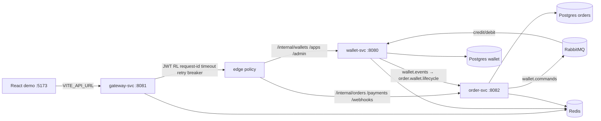

# inapp-wallet

Closed-loop **in-app coin wallet** for an OTT-style platform — not crypto, not cash-out, not P2P.

Go microservices (`wallet-svc`, `order-svc`, `gateway-svc`) plus a React demo UI. Coins are integers; PostgreSQL is the source of truth; RabbitMQ carries credit/debit commands and lifecycle events; Redis backs rate limiting.

## Architecture



### Services

| Service | Port | Role |
|---|---|---|
| **gateway-svc** | `8081` | Public edge: JWT + `X-Scopes` + `X-App-Id`, Redis rate limit, `X-Request-ID`, path-transparent reverse proxy, timeouts / GET retries / circuit breaker, Prometheus `/metrics` |
| **wallet-svc** | `8080` | Double-entry ledger, user/APP/MINT wallets, Rabbit consumers for credit/debit, outbox for lifecycle events |
| **order-svc** | `8082` | Purchase + spend orders, payment simulate webhook, outbox commands to wallet, lifecycle consumer |
| **frontend** | `5173` | Demo UI; talks **only** to the gateway |

### Request path (sync)

Browser → **gateway** (`Authorization`, `X-Scopes`, `X-App-Id`, optional `X-Request-ID`) → wallet or order by path prefix. Paths stay `/api/v1/...` (no `/wallet` rewrite).

`POST /api/v1/webhooks/payment` skips JWT at the gateway (still rate-limited); order-svc verifies `X-Payment-Signature`.

### Async money movement

| Flow | Steps |
|---|---|
| **Purchase** | Create order → simulate payment → webhook marks `paid` → outbox `TOKEN_PURCHASE` → wallet credits user / debits APP pool → `wallet.credited` → order `completed` |
| **Spend** | Create spend order → outbox `SPEND` → wallet debits user / credits APP → `wallet.debited` → order `completed` |

Failures publish `*_failed` and move the order to `failed`. Poll `GET /api/v1/internal/orders/{id}` until terminal.

### Double-entry (wallet)

| Type | Role |
|---|---|
| `USER` | End-user balance per `(app_id, user_id)` |
| `APP` | Pre-funded pool shards (`APP_WALLET_SHARDS`, sticky by `user_id`) |
| `MINT` | Ops counterparty for `APP_FUND` |

Every mutation writes two ledger legs so credits and debits balance.

### Auth model

- HS256 service JWT (`JWT_SECRET`), min 32 bytes  
- Permissions via `X-Scopes` (not embedded in the token)  
- Tenancy via `X-App-Id`  
- Demo frontend mints JWTs in-browser with `VITE_JWT_SECRET` — **dev only**, not a production pattern  
- Backends keep validating even behind the gateway (defense in depth)

## Quick start (Docker)

Requires Docker Compose v2 (`docker compose` or `docker-compose`).

```bash
# 1) Infra + apps
docker-compose up -d --build

# 2) Schema (once per fresh volume)
docker-compose --profile migrate run --rm wallet-migrate
docker-compose --profile migrate run --rm order-migrate

# 3) Restart apps if they started before migrate finished
docker-compose up -d wallet-svc order-svc gateway-svc
```

| URL | What |
|---|---|
| http://localhost:8081 | Gateway (public API) |
| http://localhost:8081/swagger | Gateway edge contract |
| http://localhost:8080/swagger | Wallet API |
| http://localhost:8082/swagger | Order API |
| http://localhost:15672 | RabbitMQ UI (`guest` / `guest`) |
| http://localhost:8081/metrics | Gateway Prometheus metrics |

### Fund the APP pool (required before purchases)

```bash
TOKEN=$(node --input-type=module -e "
import { SignJWT } from 'jose';
const secret = new TextEncoder().encode('dev-only-jwt-secret-change-me-now!!!!!!');
console.log(await new SignJWT({}).setProtectedHeader({ alg: 'HS256' }).setExpirationTime('1h').sign(secret));
")

curl -s -X POST http://localhost:8081/api/v1/internal/apps/fund \
  -H "Authorization: Bearer $TOKEN" \
  -H "X-App-Id: 6a6899644aef7603d8dd7e1a" \
  -H "X-Scopes: wallet:admin" \
  -H "Content-Type: application/json" \
  -d '{"amount":1000000,"order_id":"fund-demo-1","idempotency_key":"order:fund-demo-1:fund"}'
```

### Frontend demo

```bash
cd frontend
cp .env.example .env   # VITE_API_URL=http://localhost:8081
npm install
npm run dev
```

Open http://localhost:5173.

## Local Go (without building app images)

```bash
docker-compose up -d wallet-postgres order-postgres redis rabbitmq
docker-compose --profile migrate run --rm wallet-migrate
docker-compose --profile migrate run --rm order-migrate

# terminals
cd backend/wallet-svc && cp -n .env.example .env && go run ./cmd
cd backend/order-svc  && cp -n .env.example .env && go run ./cmd
cd backend/gateway-svc && cp -n .env.example .env && go run ./cmd   # or: air
```

Point `.env` Redis/Postgres/Rabbit URLs at localhost ports from the compose file (`5432`, `5433`, `6379`, `5672`). Gateway upstreams stay `http://localhost:8080` and `http://localhost:8082`.

## Repository layout

```
.
├── docker-compose.yml          # full stack
├── README.md
├── backend/
│   ├── gateway-svc/            # edge proxy :8081
│   ├── wallet-svc/             # ledger + Rabbit consumer :8080
│   └── order-svc/              # orders + payment simulate :8082
└── frontend/                   # React + Vite demo
```

## Design notes

- **Path-transparent gateway** — same `/api/v1` paths; route table by prefix.  
- **Outbox + Rabbit** — orders never credit/debit Postgres in another service synchronously; wallet is the money authority.  
- **Idempotency** — order/wallet mutations keyed for safe retries.  
- **Resilience at the edge** — per-upstream timeout, safe GET/HEAD retries, circuit breaker (`503` when open).  
- **Observability** — Zap access logs with `request_id`; gateway Prometheus counters/histograms/breaker gauge.

## Money correctness

Contract, idempotency matrix, and known holes: [docs/money-correctness.md](docs/money-correctness.md).

After the stack is up and migrated:

```bash
./scripts/smoke-money.sh
```

## Failure & resilience

Failure catalog (expected effects + recovery): [docs/failure-modes.md](docs/failure-modes.md).

```bash
# unit proofs
cd backend/gateway-svc && go test -race ./...
cd backend/order-svc && go test -race ./internal/services/...

# stack drills (compose up + migrated)
./scripts/drill-outbox-recovers.sh
./scripts/drill-poison-ack.sh
./scripts/drill-rabbit-blip.sh
```

## Docs per service

- [docs/money-correctness.md](docs/money-correctness.md)  
- [docs/failure-modes.md](docs/failure-modes.md)  
- [backend/gateway-svc/README.md](backend/gateway-svc/README.md)  
- [backend/wallet-svc/README.md](backend/wallet-svc/README.md)  
- [backend/order-svc/README.md](backend/order-svc/README.md)  
- [frontend/README.md](frontend/README.md)
